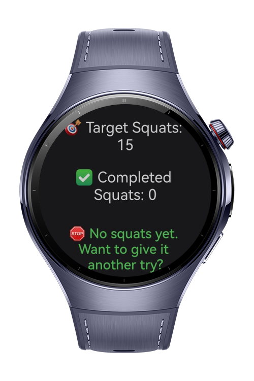
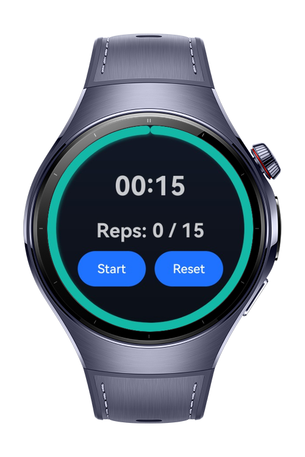

> **Note:** To access all shared projects, get information about environment setup, and view other guides, please visit [Explore-In-HMOS Index](https://github.com/Explore-In-HMOS/hmos-index).

# HIIT Squat Trainer

workout-center is a HarmonyOS-based wearable app that guides users through high-intensity interval training focused on squats. It uses the device accelerometer to detect squat repetitions in real time and manages sessions based on user-defined duration and squat goals.

# Preview

<p align="center">
  
  
  
  
</p>

# Use Cases
- Set workout duration and squat target, then start a guided session.
- Track real-time squat count via accelerometer feedback.
- Visualize progress with a countdown gauge and target completion.
- Pause or reset the session at any time.
- Review session results and get motivational feedback.

# Technology

## Stack
- **Languages & UI**: ArkTS, HarmonyOS ArkUI (Declarative)
- **SDK / Tools**: DevEco Studio, HarmonyOS Wearable
- **Sensors / APIs**: SensorServiceKit, Vibrator, Reminder Agent, Navigation
- **Animation**: Lottie JSON animation with a Canvas renderer

## Build and Pipeline

Use the repository build script for local automation or CI on Windows:

```powershell
.\scripts\build-hap.ps1
```

The script runs `ohpm install`, then `hvigorw assembleHap --no-daemon`. It also puts DevEco Studio's JBR at the front of `PATH` and removes Oracle `javapath`, which avoids stale Java/Hvigor daemon failures during `PackageHap`.

Useful environment variables:
- `DEVECO_JBR_HOME`: path to DevEco Studio JBR, for example `D:\DevelopmentStuff\IDE\deveco\DevEco Studio\jbr`.
- `DEVECO_STUDIO_HOME`: DevEco Studio root; the script will use its `jbr` folder.
- `OHOS_TOOLS_BIN`: folder containing `ohpm.bat` and `hvigorw.bat` if they are not on `PATH`.

For pipeline reproducibility, keep `entry/oh-package-lock.json5` committed with the project. Signing assets such as `.p12`, `.cer`, `.p7b`, `.csr`, and passwords should stay outside the repository and be injected by the CI secret store when release signing is required.

## Required Permissions
The following permissions are declared in `entry/src/main/module.json5`:

```json5
{
  "requestPermissions": [
    { "name": "ohos.permission.ACCELEROMETER" },
    { "name": "ohos.permission.VIBRATE" },
    { "name": "ohos.permission.PUBLISH_AGENT_REMINDER" }
  ]
}
```

## Diagrams - Process
```sequence
User->HIIT Trainer App: Start workout session
App->Sensor API: Track squat repetitions
Sensor API->App: Send accelerometer data
App->User: Display progress and feedback
```

# Directory Structure

```text
main/
|-- ets/
|   |-- animation/
|   |   `-- LottieAnimation.ets
|   |-- core/
|   |   |-- models/
|   |   |-- motion/
|   |   `-- services/
|   |-- pages/
|   |   |-- SplashPage.ets
|   |   |-- Index.ets
|   |   |-- MainPage.ets
|   |   |-- DetailPage.ets
|   |   `-- ProgressPage.ets
|   `-- util/
|       `-- ConstantUI.ets
`-- resources/
    |-- base/element/
    |   |-- color.json
    |   `-- string.json
    |-- dark/element/
    |   `-- color.json
    `-- rawfile/
        `-- splash.json
```

# Constraints and Restrictions

## Supported Devices
- Huawei Watch 5
- DevEco Studio Simulator

- **Sensor Accuracy and Motion Variance**
  - Squat detection relies on accelerometer signals. Accuracy may vary with device type or wrist motion. Calibrate thresholds for specific devices as needed.

- **Performance and Battery**
  - Continuous sensor sampling and animations can drain battery. Ensure efficient sampling intervals, and stop animations during `onDisAppear`, `onPageHide`, or `aboutToDisappear`.

- **Offline Behavior**
  - The app is fully functional without a network connection.

- **Localization (i18n)**
  - Default strings and UI colors are centralized in `entry/src/main/resources/*/element/`. Add locale-specific `string.json` files there for production localization.

- **Form Factor**
  - Layouts are optimized for circular wearable screens. Verify on other screen sizes to prevent clipping or misalignment.

- **Deprecated APIs**
  - Avoid using legacy methods like `subscribeAccelerometer` and `unsubscribeAccelerometer`. Use `sensor.on(...)` and `sensor.off(...)` from the SensorServiceKit instead.

# License (MIT)

HIIT Squat Trainer is distributed under the terms of the MIT License.
See the [LICENSE](./LICENSE) file for more information.
