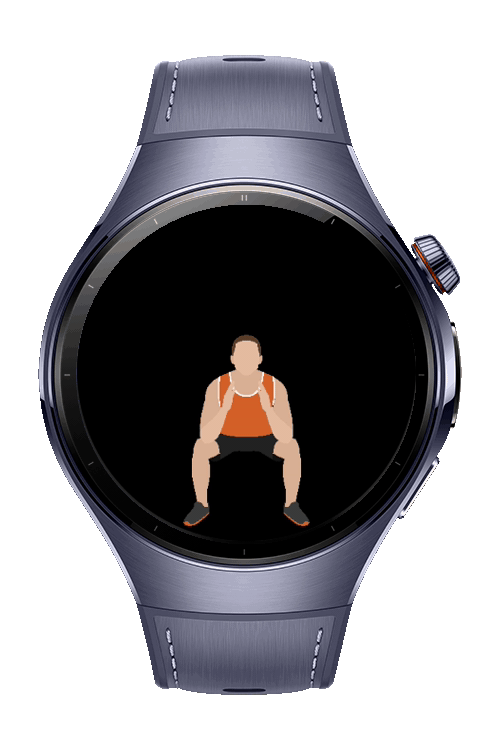
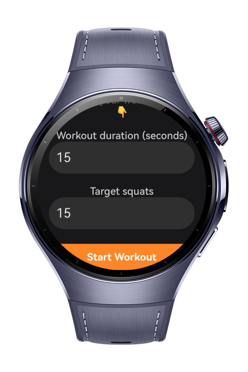

> **Note:** To access all shared projects, get information about environment setup, and view other guides, please visit [Explore-In-HMOS-Wearable Index](https://github.com/Explore-In-HMOS-Wearable/hmos-index).

# HIIT Squat Trainer

HIIT Squat Trainer is a HarmonyOS-based wearable app that guides users through high-intensity interval training focused on squats. It uses the device accelerometer to detect squat repetitions in real time and manages sessions based on user-defined duration and squat goals.

# Preview

<p align="center">
  
  
  
  
</p>

# Use Cases
- Set workout duration (seconds) and squat target, then start a guided session.
- Track real-time squat count via accelerometer feedback.
- Visualize progress with a countdown gauge and target completion.
- Pause or reset the session at any time.
- Review session results (target vs completed) and get motivational feedback.

# Technology

## Stack (Languages, Frameworks, Tools, Libraries, 3rd Party)
- **Languages & UI**: ArkTS, HarmonyOS ArkUI (Declarative)
- **SDK / Tools**: DevEco Studio, HarmonyOS Wearable
- **Sensors / APIs**: SensorServiceKit (Accelerometer), Router/navigation via HarmonyOS UI kits, Lottie JSON animation (Canvas renderer)

## Required Permissions
The following permissions are required and should be declared in the `entry/src/main/module.json5` file:
```json5
{
  "requestPermissions": [
    { "name": "ohos.permission.ACCELEROMETER" }
  ]
}
```

## Diagrams - Process
```sequence
User->HIIT Trainer App: Start workout session
App->Sensor API: Track squat repetitions
Sensor API->App: Send accelerometer data
App->User: Display progress and feedback
```

# Tech Stack
- ArkTS
- HarmonyOS ArkUI
- SensorServiceKit
- DevEco Studio

# Directory Structure

```text
main/
├── ets/
│   ├── animation/
│   │   └── LottieAnimation.ets
│   ├── core/
│   │   └── services/
│   │       ├── TimerService.ets
│   │       └── NavigationService.ets
│   ├── pages/
│   │   ├── SplashPage.ets
│   │   ├── Index.ets
│   │   ├── MainPage.ets
│   │   └── DetailPage.ets
│   └── util/
│       └── ConstantUI.ets
└── resources/
    ├── rawfile/
    │   └── splash.json
    └── assets/
        ├── splash.gif
        ├── index_screenshot.png
        ├── mainpage_screenshot.png
        └── detail_screenshot.png
```

# Constraints and Restrictions

## Supported Devices
- Huawei Watch 5
- DevEco Studio Simulator

- **Sensor Accuracy and Motion Variance**
  - Squat detection relies on accelerometer signals. Accuracy may vary with device type or wrist motion. Calibrate thresholds for specific devices as needed.

- **Performance and Battery**
  - Continuous sensor sampling and animations can drain battery. Ensure efficient sampling intervals, and stop animations during `onDisAppear`, `onPageHide`, or `aboutToDisappear`.

- **Offline Behavior**
  - The app is fully functional without a network connection.

- **Localization (i18n)**
  - Default strings are in English. Replace hard-coded text with resource references and include localized strings for production.

- **Form Factor**
  - Layouts are optimized for circular wearable screens. Verify on other screen sizes to prevent clipping or misalignment.

- **Deprecated APIs**
  - Avoid using legacy methods like `subscribeAccelerometer` and `unsubscribeAccelerometer`. Use `sensor.on(...)` and `sensor.off(...)` from the SensorServiceKit instead.

# License (MIT)

HIIT Squat Trainer is distributed under the terms of the MIT License.  
See the [LICENSE](./LICENSE) file for more information.